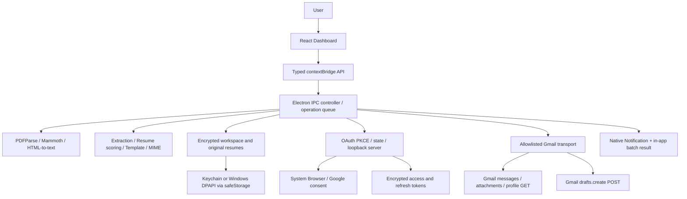

# Architecture

## Technical Context

Greenfield desktop app: Electron main process, sandboxed React renderer, narrow context-isolated preload, shared TypeScript domain engine, local encrypted files. Vite builds the renderer; TypeScript compiles Electron ESM plus a CommonJS preload. electron-builder creates macOS and Windows artifacts. Node 24 is a development prerequisite only.

No remote application backend, Python runtime, LLM account, or paid notification provider is required. Google OAuth/Gmail are the only application network services. Fonts and icons are packaged locally. The browser preview is a separate in-memory adapter with fictional data, never a substitute for native integration.



There is deliberately no `messages.send`, `drafts.send`, SMTP transport, send IPC handler, or background sending process.

## Ownership

| Module | Responsibility |
| --- | --- |
| `electron/main.ts` | Window isolation, trusted IPC validation, serialization, import orchestration, reranking, draft batches, notifications. |
| `electron/preload.cts` | Fixed typed methods only; no generic invoke, path access, credentials, or raw network API. |
| `electron/storage.ts` | OS-encrypted JSON files, atomic rename, restrictive file modes, metadata-only rotating logs. |
| `electron/documents.ts` | PDF/DOCX text extraction, size/text limits, scanned-document errors, parser cleanup. |
| `electron/gmail.ts` | Credential import, OAuth code exchange/refresh/revoke, request allowlist, email pagination, attachment extraction. |
| `shared/engine.ts` | Deterministic field/skill/experience extraction, content identity, per-resume scoring, truthful template values, multipart MIME. |
| `shared/types.ts` | Serializable entities, API contract, defaults. |
| `src/api.ts` | Native adapter or explicitly labeled isolated browser demonstration. |
| `src/App.tsx` | Dashboard, resume library, preference/template forms, file/Gmail import, review dialogs, batch confirmation, notifications. |

## Folder Structure

```text
job-applicant-agent/
  .github/workflows/release.yml
  docs/
    architecture.md
    constitution.md
    requirements.md
    plan.md
    RELEASE.md
    checkpoints/
      spec-to-plan.yaml
      plan-to-tasks.yaml
    security/cve-report.json
  electron/
    main.ts
    preload.cts
    documents.ts
    gmail.ts
    storage.ts
  shared/
    types.ts
    engine.ts
  src/
    main.tsx
    App.tsx
    api.ts
    styles.css
  public/mark.svg
  tests/
    engine.test.ts
    services.test.ts
    desktop.smoke.mjs
  index.html
  package.json
  package-lock.json
  tsconfig.json
  tsconfig.electron.json
  vite.config.ts
```

Generated outputs: `dist/` (renderer), `dist-electron/` (main/preload/shared), `release/` (installers), `test-results/` (smoke screenshots). Dependencies and outputs are ignored by Git.

## Data Model

- **Preferences:** locations, skill/custom dictionary terms, minimum match, applicant name, template.
- **Resume:** UUID, original file name, extracted text, detected skills/years, import timestamp. Original bytes are in a separate encrypted file referenced only by UUID.
- **Job:** content-derived ID, fields/text/source/timestamp, skill/year requirements, current score/best resume/evidence/missing skills, draft ID/status/error, and the resume ID actually used for the created draft.
- **Workspace:** preferences, jobs, resumes, connected email, OAuth client ID, last retrieval timestamp. OAuth client secret and access/refresh tokens are separate encrypted files and never returned to the renderer.

Job documents are grouped from uploaded filename sources, including legacy imports; Gmail attachments are excluded from this library. Removing a document deletes all local jobs with that filename after confirmation, including local draft records, without changing original files, resumes, or Gmail drafts. The optional public OAuth project reference is retained from Desktop JSON or the legacy client-ID prefix and used to target fixed Google Console setup URLs; it does not establish Google account approval.

The workspace is an encrypted JSON snapshot. Mutations run through one main-process promise queue; each write uses a temporary file and atomic rename. This avoids competing writes in a single-instance app. Suitable for a personal job search, not a multi-user database. Large accumulated workspaces need future retention/indexing work.

## Primary Flows

### Import And Match

1. Native dialog selects files; renderer cannot choose arbitrary paths.
2. Reject unsupported/oversized files; parse text locally and clean up parser resources.
3. Split repeated/numbered job headings into separate roles while retaining continuation pages. Extract structured fields, known/custom/QA skills, and experience per role. Content hash deduplicates descriptions. Re-analysis expands previously imported undrafted aggregates and preserves draft records.
4. Compare each job with every resume using resume skill evidence plus separate configured preference/location/experience components. Resume selection first compares coverage of relevant configured tools (weight 3 for a tool named in the job title versus 1 otherwise), then overall match score. Never infer qualifications from resume filenames.
5. Sort jobs by selected-resume score, encrypt/persist, display. Removing resumes or saving preferences reranks jobs. Matching/draft eligibility requires the threshold, a resume, recognized skills, and the configured Any/All skill rule. Any gives full focus-preference credit for one or more alternatives; All scores the fraction present and requires every configured skill for eligibility. Unrelated records remain in All jobs. Preview and draft creation rerank before using the selected resume.

Gmail retrieval accepts structured dates, literal comma-separated terms with Any/All mode, and an independent advanced Gmail query. Term groups and advanced expressions are parenthesized before combining with date bounds. Inclusive dates become local-midnight epoch bounds, including the end day. Pagination stops at 200 emails. Supported attachments are independently extracted; HTML is converted rather than rendered. There is no permanent inbox polling or access to unrelated mail unless included in the user's query.

Each parsed email body/attachment carries message ID, subject, sender, received timestamp, and optional attachment filename. Jobs retain multiple distinct origins when duplicate content is retrieved; re-extraction carries provenance forward. Legacy records without provenance display an explicit resync hint. `lastGmailSearch` stores the latest criteria and encountered job IDs separately from the retained workspace. The renderer can scope the list to those IDs and reset that scope without destructive deletion. Batch drafting uses only visible eligible jobs.

### OAuth

1. Discover an optional publisher-provided Desktop client from `resources/google-oauth.json` and encrypt a local copy. Otherwise show a guided Google Console setup with fixed API/Auth/Clients links; user imports `installed` Desktop credentials JSON through a native file picker. Validate and encrypt. Imported configuration takes precedence. Ordinary sign-in does not require JSON after this one-time configuration.
2. Generate random verifier, SHA-256 PKCE challenge, and state. Bind a random temporary port on `127.0.0.1` only.
3. Open Google's HTTPS authorization URL in the system browser.
4. Check callback path/state; exchange code/verifier/redirect/client credentials with Google.
5. Encrypt tokens, read profile, persist email. Close callback server and clear timer on completion/failure. Authorization times out after three minutes.
6. Refresh access tokens near expiry; preserve refresh tokens. Disconnect attempts revocation and clears local tokens even on network failure.

### Draft Batch

1. User reviews a job/email preview and/or selects eligible matching jobs, then confirms creation.
2. For each job, skip missing/under-threshold/already-created records.
3. Render stored template using selected resume evidence and job fields. Validate recipient and header safety. Encode UTF-8 multipart MIME plus original PDF/DOCX resume.
4. Transport allows exactly `POST /drafts`. Persist returned ID and the used resume ID after every job.
5. Continue after per-job failures; show failed status/error. Never retry a POST automatically.
6. Show created/failed/skipped counts and emit a native completion notification. User reviews/sends in Gmail.

There is no distributed transaction between Google and local disk. A timeout/crash/disk failure after Google accepts a draft can leave uncertain status. The user must inspect Gmail before retrying. A persisted draft ID prevents normal rerun duplicates, but is not an exactly-once guarantee.

## Security And Failure Boundaries

- BrowserWindow uses `nodeIntegration: false`, `contextIsolation: true`, `sandbox: true`.
- Preload exposes fixed methods; main rejects untrusted windows/frames and validates all incoming arguments with Zod.
- Popup creation/navigation and renderer permission requests are denied. Only fixed Google authorization/Gmail URLs are opened externally.
- CSP restricts scripts, assets, connections, objects, forms, and base URLs. The loopback development connection allowance is not used by application services.
- No resume/JD/credential values in logs. General logs record only operation/category/count. Errors shown inside the encrypted workspace may include filenames and job-specific failure context.
- No fallback to plaintext token storage. Keychain unavailability, corrupt encrypted data, malformed documents, missing recipients, OAuth cancellation/expiry, and Gmail API errors surface to the user rather than being hidden.
- Parser input limits reduce accidental overload, but are not a complete hostile-document sandbox. Parse only trusted documents; pathological compressed DOCX/PDF input can exhaust resources. Worker/process isolation and decompression quotas are future hardening for arbitrary adversarial input.
- Native completion notifications are best-effort, permission dependent, free, and supplemented by in-app results.

## Tradeoffs And Extensions

Deterministic matching is free, private, reproducible, and honest, but cannot deeply interpret arbitrary prose, negations, or implicit seniority. A future optional structured LLM adapter should retain explicit review, provenance, credential protection, and the same draft-only transport boundary. OCR, background syncing, job-board APIs, multi-account Gmail, robust document-worker resource quotas, database migration/versioning, and draft reconciliation are intentionally outside this implementation.